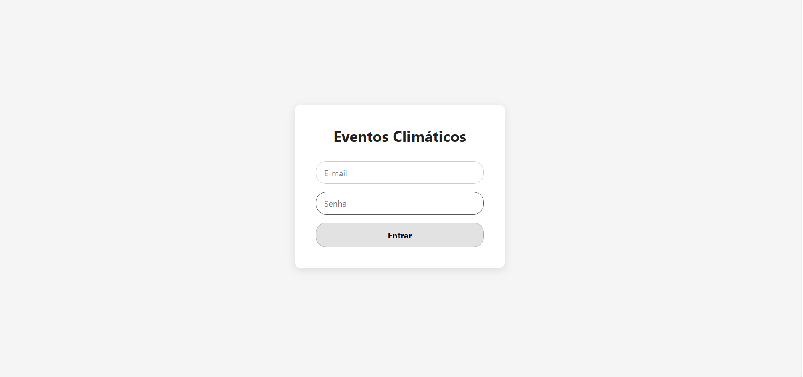
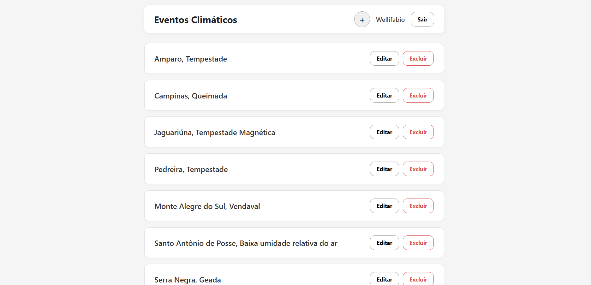

# Sistema de Eventos Climáticos

Sistema web desenvolvido com **Node.js, Express, Prisma ORM e MySQL** no back-end e **HTML, CSS e JavaScript** no front-end para realizar o gerenciamento de eventos climáticos.

O projeto foi desenvolvido como parte da Situação de Aprendizagem da **Aula 05 — Recursos Avançados: Prisma Seed**, integrando uma API a uma interface web.

## Funcionalidades

- Tela de login com validação de acesso utilizando os dados cadastrados no banco de dados.
- Tela inicial com exibição dinâmica do nome do usuário logado.
- Botão para sair do sistema e retornar à tela de login.
- Listagem de eventos climáticos no formato Cidade, Tipo de Evento.
- Cadastro de novos eventos climáticos.
- Edição de eventos cadastrados.
- Exclusão de eventos.
- Visualização dos detalhes dos eventos em um modal interativo.
- Exibição de informações como temperatura máxima e nível de impacto.

## Tecnologias utilizadas

- Node.js
- Express
- Prisma ORM
- MySQL
- HTML5
- CSS3
- JavaScript
- Fetch API
- Insomnia
- Visual Studio Code
- XAMPP

## Telas do sistema

### Tela de Login

Tela utilizada para realizar a autenticação do usuário por meio do e-mail e da senha cadastrados no banco de dados.



---

### Tela inicial

Tela principal do sistema, onde são exibidos os eventos climáticos cadastrados, com acesso às funcionalidades de gerenciamento e identificação do usuário logado.



---

## Requisitos funcionais atendidos

- **RF001 — Tela de Login:** validação de acesso com base nos e-mails e senhas cadastrados no banco de dados por meio do Seed.
- **RF002 — Tela Home:** exibição da página principal do sistema após o login.
- **RF002.1 — Identificação do usuário:** exibição dinâmica do nome do usuário logado no cabeçalho.
- **RF002.2 — Sair do sistema:** botão para retornar à tela de login.
- **RF002.3 — CRUD de eventos climáticos:** listagem, cadastro, edição, exclusão e visualização dos detalhes dos eventos.

## Estrutura do projeto

O projeto está organizado em duas partes principais: `api`, responsável pelo back-end e pela comunicação com o banco de dados, e `web`, responsável pela interface do usuário.

As imagens utilizadas no README estão armazenadas na pasta `imagens`.

```text
eventos/
├── api/
│   ├── prisma/
│   ├── src/
│   ├── .env
│   └── package.json
│
├── web/
│   ├── index.html
│   ├── style.css
│   └── script.js
│
├── imagens/
│   ├── login.png
│   └── home.png
│
└── README.md
```

## Como executar o projeto

### Back-end

Acesse a pasta `api` pelo terminal e execute os seguintes comandos.

**Instalar as dependências:**

```bash
npm install
```

**Gerar o Prisma Client:**

```bash
npx prisma generate
```

**Executar as migrações do banco de dados:**

```bash
npx prisma migrate dev --name init
```

**Popular o banco de dados com os dados de teste:**

```bash
npx prisma db seed
```

**Iniciar o servidor:**

```bash
npm run dev
```

O servidor estará disponível em `http://localhost:3000`.

> **Importante:** configure o arquivo `.env` com os dados de conexão do MySQL antes de executar as migrações.

### Front-end

1. Abra a pasta `web` no Visual Studio Code.
2. Utilize a extensão Live Server.
3. Abra o arquivo `index.html` com a opção **Open with Live Server**.

## Autor

- **Clara Andrzejewsky Antonacci**
- Técnico em Desenvolvimento de Sistemas
- **Atividade:** Aula 05: Recursos Avançados: Prisma Seed
